# tubedeck

A practice DJ console for the browser, laid out like a Pioneer DDJ-FLX4 in rekordbox's Performance mode, that plays tracks from YouTube or your own audio files. It's made for practicing mixing on an iPad or a laptop, not for performing.

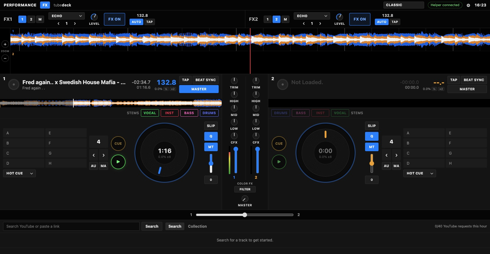

## Contents

- [What it does](#what-it-does)
- [Quick start](#quick-start)
- [How it works](#how-it-works)
- [Using it](#using-it)
- [How YouTube requests are throttled](#how-youtube-requests-are-throttled)
- [Project layout](#project-layout)
- [Developing](#developing)
- [Tests](#tests)
- [Configuration](#configuration)
- [Troubleshooting](#troubleshooting)
- [Credits and references](#credits-and-references)
- [Screenshots](#screenshots)
- [Notes](#notes)

## What it does

- **Two decks:** waveform overview and scrolling waveforms, Pioneer-style CUE, play/pause, a jog wheel you can scratch, tempo ±8% with key lock, automatic BPM detection (with ½ and ×2 fixes), TAP, SYNC and MASTER.
- **Cues and loops:** 8 hot cues, beat loops from 1/32 to 512 beats (pads cover 1/4 to 32), manual loop in/out, beat jump, slip mode and ROLL.
- **Mixer:** trim, 3-band EQ, Color FX (filter, dub echo, noise, crush, jet), channel faders with meters and an equal-power crossfader.
- **Beat FX:** echo, delay, ping pong, spiral, reverb, flanger, phaser, trans, filter and crush, plus vinyl brake and back spin (hold to use; the track carries on as if it never stopped).
- **Stems:** split a downloaded track into vocals, instruments, bass and drums, then mute or isolate them (optional, needs [Demucs](#stems-optional)).
- **Headphone cueing:** CUE buttons and four routing modes, including split cue for a single pair of headphones and a DJ controller's 4-output sound card.
- **DJ controllers:** built-in mappings for the Pioneer DDJ-FLX4 and DDJ-1000, with lights, plus MIDI learn for any other controller.
- **Your own files:** drag MP3, WAV, M4A/AAC, FLAC, OGG/Opus or AIFF files onto a deck, or use Open file.
- **Themes:** 16 of them, from plain colour schemes to live 3D scenes that move with the music.
- **iPad:** works in Safari on the same Wi-Fi, or from anywhere over HTTPS with Tailscale, and installs to the home screen.

## Quick start

You need Python 3.10 or later and an up-to-date [yt-dlp](https://github.com/yt-dlp/yt-dlp):

```bash
python3 -m pip install -U yt-dlp
git clone https://github.com/GYberkeley/tubedeck.git
cd tubedeck
python3 server.py
```

The helper prints links with a pairing code, for example `http://192.168.1.20:8765/?t=abc123`. Open one in a browser on this computer, or on an iPad on the same Wi-Fi. The page saves the pairing code, so you only need the full link once. On macOS, allow Python to accept incoming connections if asked.

There is no build step and nothing to install for the web app: it is plain HTML, CSS and JavaScript.

## How it works

tubedeck has two halves:

- **The helper (`server.py`)** is a small Python web server with no dependencies beyond the standard library. It serves the web app, searches YouTube, downloads each track's audio once with yt-dlp (through one shared throttle), caches it, and optionally separates stems with Demucs. Every API call needs the pairing code.
- **The web app (`web/`)** runs entirely in the browser. Once a track's audio arrives, everything else happens there: decoding, BPM and waveform analysis (in a Web Worker), playback, scratching and loops (a custom audio engine), the mixer and effects (Web Audio), controllers (Web MIDI) and the themes (WebGL).

A typical load goes like this:

1. You search or paste a link. The page asks the helper (or, with your own API key, asks YouTube directly).
2. You load a result onto a deck. The page asks the helper to fetch it. The helper queues the download behind the throttle, runs yt-dlp, and saves the audio in its cache.
3. The page downloads the cached audio from the helper, decodes it, and analyzes it for BPM, beat grid and waveform.
4. If Demucs is installed, the helper separates stems in the background and the page swaps them in when they're ready, without a gap.

Local files skip the helper entirely: the page reads them from disk.

The helper keeps its data in `~/.tubedeck`:

- `token`: the pairing code
- `cache/`: downloaded audio and track info (each track is downloaded only once)
- `cache/stems/`: separated stems
- `throttle.json`: throttle state, so the limits survive restarts

## Using it

### On an iPad

On the same Wi-Fi, open the `http://<your-computer>:8765/?t=…` link the helper prints in Safari. Everything works except DJ controllers (Safari has no Web MIDI). Plain `http://` pages get the fallback audio engine, which is a little more prone to glitches under heavy load; HTTPS fixes that.

### From anywhere, over HTTPS (Tailscale)

The helper is a small web server: the iPad opens a link to it, the page then runs on the iPad, and the helper does the YouTube searching, downloading and stem separation. On the same Wi-Fi the link the helper prints just works. To use it from anywhere, and over HTTPS (which gives the iPad the better audio engine, a home-screen app and a screen that stays on while playing), use [Tailscale](https://tailscale.com), a free private network between your own devices:

1. Install Tailscale on the computer that runs the helper and on the iPad, and sign in to the same account on both.
2. On the computer, turn on HTTPS for your devices once in the Tailscale admin console (DNS, then HTTPS Certificates), then run:
   ```bash
   tailscale serve --bg 8765
   ```
   This gives the helper a private HTTPS address like `https://your-mac.your-tailnet.ts.net` that only your own devices can reach. It keeps working across restarts; `tailscale serve reset` turns it off.
3. Start the helper as usual. It prints the Tailscale link (with the pairing code) next to the Wi-Fi ones.
4. On the iPad, open that link in Safari. To install it: Share, then Add to Home Screen. The installed app keeps its own storage, so it asks for the pairing code once.

The pairing code is still required on every address, and the helper only answers your own devices. The computer running the helper has to stay on and awake.

#### An always-on helper on a Raspberry Pi (optional)

If your Mac is a laptop you carry around, a Raspberry Pi 4 or 5 left plugged in at home can be the helper instead (stems are slow on a Pi, so skip them there):

```bash
sudo apt install -y python3 python3-pip git ffmpeg
python3 -m pip install -U --break-system-packages yt-dlp
git clone https://github.com/GYberkeley/tubedeck.git && cd tubedeck
python3 server.py
```

To start it on boot, create `/etc/systemd/system/tubedeck.service`:

```ini
[Unit]
Description=tubedeck helper
After=network-online.target

[Service]
User=pi
WorkingDirectory=/home/pi/tubedeck
ExecStart=/usr/bin/python3 server.py
Restart=on-failure

[Install]
WantedBy=multi-user.target
```

Then run `sudo systemctl enable --now tubedeck`, install Tailscale on the Pi (`curl -fsSL https://tailscale.com/install.sh | sh`, then `sudo tailscale up`) and run `tailscale serve --bg 8765` there. Update yt-dlp now and then with `python3 -m pip install -U --break-system-packages yt-dlp`, since YouTube changes often. The pairing code is in `~/.tubedeck/token` on the Pi.

### Searching YouTube with your own API key (optional)

Searches go through the helper by default. To search directly from the browser on your own free daily allowance (about 100 searches), add a YouTube Data API v3 key in Settings (⚙︎). The key is saved only in that browser. To get one: create a project at console.cloud.google.com, enable **YouTube Data API v3**, then create an API key under Credentials and restrict it to that API.

### Stems (optional)

The helper can split a downloaded track into four stems (vocals, drums, bass, other) with [Demucs](https://github.com/adefossez/demucs), so you can mute or isolate parts while you practice. Separation runs locally on this computer's CPU. (On Apple Silicon the GPU backend returns wrong stems without reporting an error, so it's off by default; set `TUBEDECK_STEMS_DEVICE` to try another device.) It never contacts YouTube and doesn't count against the throttle.

```bash
./scripts/install-stems.sh    # one-time: a venv in ~/.tubedeck/stems-venv with Demucs and PyTorch
```

The install downloads about 140 MB (PyTorch), and the htdemucs model (about 84 MB) downloads the first time you separate a track. A 6-minute track takes about 2.5 minutes (measured: 156 s) on an Apple Silicon Mac's CPU. Decks keep playing the original track; muting a stem subtracts it, so with every stem on you hear the original exactly. Stems are cached as MP3s in `~/.tubedeck/cache/stems/`, so each track is separated only once. Restart the helper after installing; it prints whether stems are available. Local files you drop in don't get stems yet.

### Your own audio files

Drag audio files onto a deck (the deck lights up), or anywhere on the page (the first empty deck gets it; two files fill both decks), or use **Open file** next to Search. Supported: MP3, WAV, M4A/AAC, FLAC, OGG/Opus and AIFF, as far as the browser can decode them. Files are read in the browser and never go to the helper or YouTube. A file named `Artist - Title.mp3` shows the title with the artist underneath.

### DJ controllers (MIDI)

Open the app in **Chrome or Edge on a computer**, at `http://localhost:8765` or an HTTPS address (Web MIDI needs a secure page; the plain LAN address doesn't count, and iPad browsers don't support MIDI at all). Plug in the controller, then Settings → DJ controller → **Connect controller**. It reconnects automatically after that.

- **Pioneer DDJ-FLX4 and DDJ-1000** are mapped out of the box: decks, jog wheels, tempo, mixer, Color FX knobs, loops, pad modes (hot cue, beat loop, beat jump, roll, and stems on the FLX4), beat FX, browse and load, headphone CUE and mix. The buttons and pads light up to match the app. Other Pioneer DDJs use the same scheme and partly work.
- **Any other MIDI controller:** click **MIDI learn**, click a control on screen, then move or press it on the controller. Learned controls are saved in the browser and win over the built-in mapping.
- The Settings panel shows a live list of incoming MIDI messages, which helps when something doesn't respond.

The mappings haven't been checked on real hardware yet. The things most likely to need tuning are jog sensitivity (especially on the DDJ-1000) and the tempo fader direction.

### Headphone cueing

Each mixer channel has a **CUE** button that sends that deck to the headphones before its channel fader. Settings → Headphones picks how the sound is routed:

- **Off:** everything through one output (the default; CUE does nothing).
- **Split cue:** one pair of headphones, master in the left ear and the cued deck in the right. Works anywhere, including the iPad.
- **DJ controller sound card:** speakers on outputs 1–2 and headphones on 3–4 of a 4-output device such as the DDJ-FLX4 or DDJ-1000 (Chrome or Edge). With fewer than 4 outputs it falls back to Off rather than putting the cue in a speaker.
- **Separate headphone device:** speakers on one output and headphones on another (Chrome or Edge). The headphones run slightly late, so beatmatch by the master.

The CUE ↔ MASTER and PHONES LEVEL knobs set what you hear in the headphones.

## How YouTube requests are throttled

Every request the helper makes to YouTube, for every person using it, goes through one queue:

- one yt-dlp process at a time, using yt-dlp's `-t sleep` preset (10–20 s before each download, 0.75 s between requests)
- at least 10 s between YouTube jobs and at most 40 per hour
- a 30-minute pause if YouTube shows a bot check or rate limit
- no cookies, so a block can only ever affect the network, never a Google account
- audio only, and each track is downloaded once and then served from the cache

Searches don't queue behind downloads: if the helper is busy, the search returns a "try again" message.

**Don't loosen these limits.** They keep the helper's traffic looking like a person, and the tests check them.

## Project layout

- `server.py`: the helper. Static file server, `/api/*` endpoints (search, fetch, status, library, audio, stems), the throttle, the download and stem queues, and pairing-code checks.
- `scripts/install-stems.sh`: one-time Demucs install into its own virtual environment.
- `web/index.html`: the page layout, including the deck, channel and FX templates and the Settings dialog.
- `web/style.css`: layout and the base look.
- `web/themes.css`: colour palettes and per-theme styling.
- `web/app.js`: the app. Decks, the audio player, mixer, Beat FX, Color FX, headphones, waveform drawing, the track browser, local files, settings, themes and the WebGL scene layers.
- `web/deck-dsp.js`: the deck audio engine (playback, key lock, scratching, loops, brake and spin, stems). It runs as an AudioWorklet on secure pages and through a ScriptProcessor fallback elsewhere, and the same code is unit-tested in Node.
- `web/analysis.js`: a Web Worker for decoding helpers, BPM and beat detection, the 3-band waveform, and lining stems up with the mix.
- `web/midi.js`: DJ controller support. The Pioneer DDJ mapping, lights, keep-alive and MIDI learn.
- `web/scenes.js`: the Waterfall and Aurora scene shaders for the waveform band.
- `web/worlds.js`: the 3D scene themes (raymarched GLSL), drawn full screen behind the console.
- `web/manifest.webmanifest` and the icons: the home-screen app.
- `tests/test_server.py`: helper tests against a fake yt-dlp and fake Demucs (offline).
- `tests/test_dsp.js`: audio engine tests (Node).
- `tests/browser_smoke.py`: end-to-end tests of the web app in headless Chrome.
- `docs/screenshots/`: one screenshot per theme.

## Developing

- **No build step.** Edit a file and refresh the page. The helper serves `web/` straight from disk and tells browsers to revalidate, so changes show up on reload. Restart the helper only after changing `server.py`.
- **No dependencies** in the web app or the helper beyond the Python standard library. Please keep it that way unless there's a strong reason.
- **Style:** vanilla JavaScript and plain CSS. Comments explain *why* rather than what. Match the surrounding code.
- **Useful URL flags:** `?t=<code>` sets the pairing code. `?sp=1` forces the ScriptProcessor audio engine (the one plain-http pages use), which is handy for reproducing iPad behaviour on a computer.
- **The app is driven through globals** (`decks`, `mixer`, `fx`, `phones`, `midi`, `applyTheme`, `loadOnDeck`), which is how the browser tests and the browser console reach it.

### Adding a theme

1. Add a palette block for `[data-theme="yourname"]` in `web/themes.css` (copy one of the existing themes; deck colours, waveform colours and panel colours are all CSS variables).
2. Add `<option value="yourname">` to the theme picker in `web/index.html`.
3. For a 3D scene, add a `yourname: WORLD(...)` entry to `WORLDS` in `web/worlds.js`. It's drawn full screen, with the waveform band as clear glass over the top. Keep the landmark inside the band (roughly `p.y` 0.19 to 0.37 at 1600×830), and dim the area behind the decks if it's busy. Look at an existing world for the structure (a distance function, `sdfKit`, `shade`, and the camera in the body).
4. Add the theme name to the list in `test_themes` in `tests/browser_smoke.py`, which checks every scene compiles.
5. Add a screenshot to `docs/screenshots/` and the gallery below.

### Adding or fixing a controller mapping

Pioneer DDJ controllers share one message scheme, handled by `pioneer()` and the functions under it in `web/midi.js`. A new Pioneer model usually just needs an entry in `PRESETS` (its name pattern and jog resolution). For other brands, write a handler with the same shape, or rely on MIDI learn. The simulated-controller test in `tests/browser_smoke.py` (`test_midi_controller`) shows how to drive the app with raw MIDI bytes.

### Contributing

- Work on a branch and open a pull request against `main`.
- Run all the tests (below) before opening it, and say in the PR what you checked.
- Never commit secrets: the pairing code (`~/.tubedeck/token`), YouTube API keys, or anything in `.env` or `*.key` (both are git-ignored).

## Tests

```bash
python3 -m unittest discover -s tests     # helper, against a fake yt-dlp and Demucs (offline)
node --test tests/test_dsp.js             # deck audio engine
python3 -W ignore tests/browser_smoke.py  # the web app in headless Chrome
ruff check .                              # Python lint
```

- The helper tests need only Python. The engine tests need Node 18 or later.
- The browser tests need Playwright for Python (`python3 -m pip install playwright`), Google Chrome, and ffmpeg (which builds the test audio). They start their own helper on a spare port with a fake yt-dlp, so they never touch YouTube or your real cache.
- The browser tests cover loading and playing, effects, stems, every theme's shaders, the layout at phone and iPad widths, headphone routing (they measure each ear), a simulated DDJ controller, and dropping a local file.

## Configuration

The helper reads these environment variables:

- `TUBEDECK_PORT`: the port (default `8765`).
- `TUBEDECK_HOME`: where the cache, pairing code and throttle state live (default `~/.tubedeck`).
- `TUBEDECK_YTDLP`: the yt-dlp command (default `yt-dlp`).
- `TUBEDECK_DEMUCS`: the Demucs command (default: the venv `scripts/install-stems.sh` creates).
- `TUBEDECK_STEMS_DEVICE`: the device Demucs uses (default `cpu`).
- `TUBEDECK_MIN_GAP`: seconds between YouTube jobs (default `10`). Tests lower it; don't lower it for real use.
- `TUBEDECK_SEARCH_WAIT`: how long a search waits for the throttle before saying "try again" (default `15`).
- `TUBEDECK_SKIP_YTDLP_CHECK`: skip the startup yt-dlp version check (used by tests).

## Troubleshooting

- **"Helper offline":** the helper isn't running, or the device can't reach it. Check that both are on the same Wi-Fi, or use Tailscale.
- **"Pairing code needed":** open the full link the helper prints once, or paste the code from `~/.tubedeck/token` into Settings.
- **Downloads fail, or the helper says it's paused:** YouTube showed a bot check, so the helper pauses for 30 minutes. If downloads keep failing, update yt-dlp (`python3 -m pip install -U yt-dlp`), because YouTube changes often.
- **Audio glitches on the iPad:** plain-http pages use the fallback audio engine. Use the Tailscale HTTPS address, and close other apps.
- **"Connect controller" says MIDI isn't available:** use Chrome or Edge on a computer, at `http://localhost:8765` or an HTTPS address.
- **Stems sound wrong or "Stems failed":** make sure `TUBEDECK_STEMS_DEVICE` is `cpu` (the default). The Apple Silicon GPU backend produces wrong stems without reporting an error.
- **Tests hang on macOS:** if the download or browser tests hang even on an unchanged checkout, macOS's `syspolicyd` may be stuck (check Activity Monitor for high CPU). While it is, newly created scripts, such as the tests' fake yt-dlp, never start. Restart the Mac or run `sudo killall syspolicyd`.

## Credits and references

- [yt-dlp](https://github.com/yt-dlp/yt-dlp) downloads the audio, and [Demucs](https://github.com/adefossez/demucs) separates the stems. Both run as separate programs; neither is bundled.
- The waveform format follows rekordbox's 3-band colour waveform, as documented by projects that read rekordbox files.
- The DJ controller mappings in `web/midi.js` were written from scratch for this app, using these open-source projects as references for which MIDI message each control sends (no code was copied):
  - [Mixxx](https://github.com/mixxxdj/mixxx) (GPL-2.0-or-later): its DDJ-FLX4 mapping was the main source for Pioneer's message scheme, the lights, the jog resolution and the FLX4's keep-alive message.
  - [pioneered-by-ntamas](https://github.com/ntamas94/pioneered-by-ntamas) (GPL-3.0): a community DDJ-1000 mapping for Mixxx that confirmed the DDJ-1000 uses the same scheme.
  - [awesome-djhardware-unchained](https://github.com/mattpstv/awesome-djhardware-unchained) (CC0): the list that led to the projects below.
  - [DJ-MIDI-Studio](https://github.com/guillain/DJ-MIDI-Studio): the model for MIDI learn and the live message monitor (design only).
  - [DDJ-SP1](https://github.com/dmvjs/DDJ-SP1): relaying MIDI from a helper to a browser, a possible route to controllers on the iPad (not used yet).

## Screenshots

Every theme, with a track playing on deck 1. The scene themes are live 3D scenes that move with the music.

<details>
<summary>Show all 16 themes</summary>

**Forest**

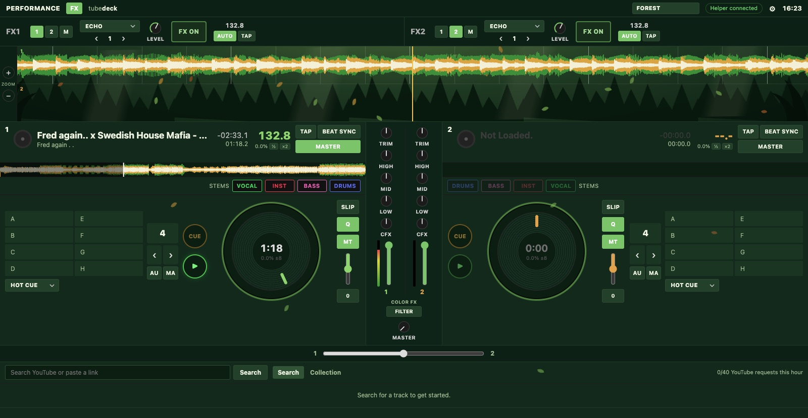

**Waterfall (with the reef below)**

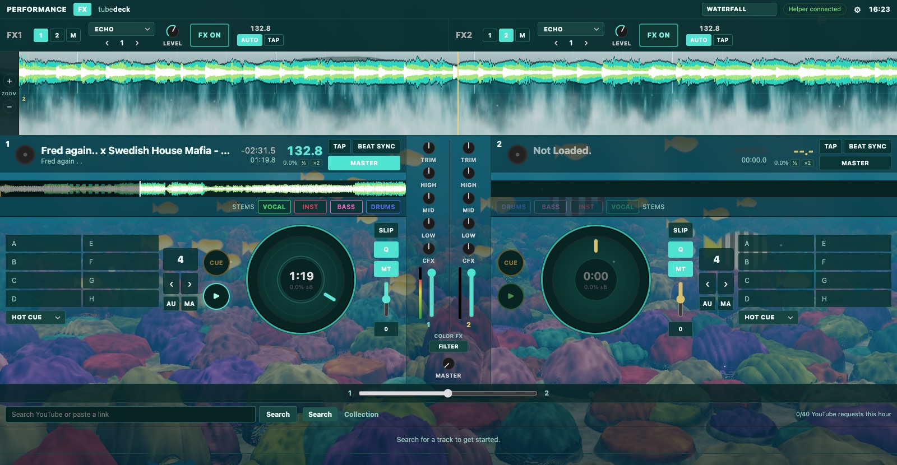

**Meadow**

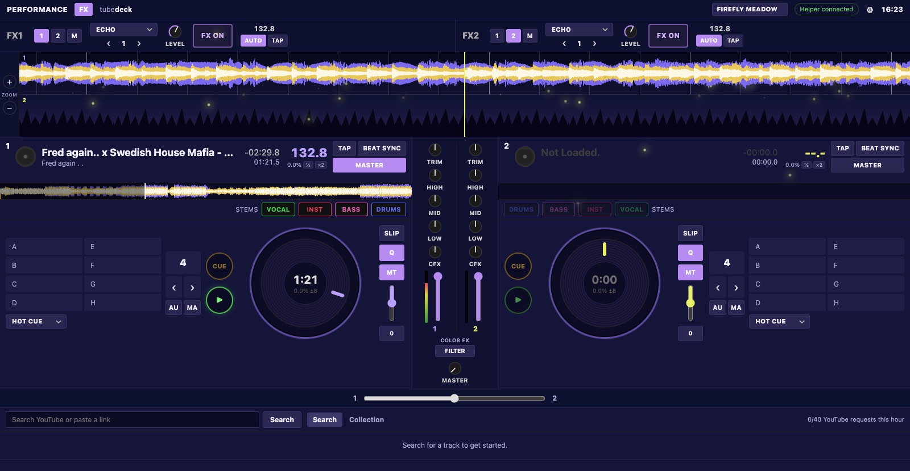

**Ocean**

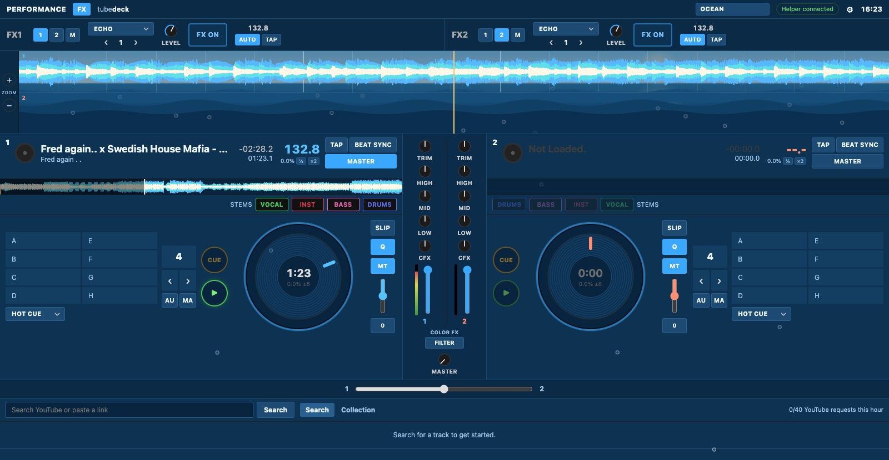

**Desert**

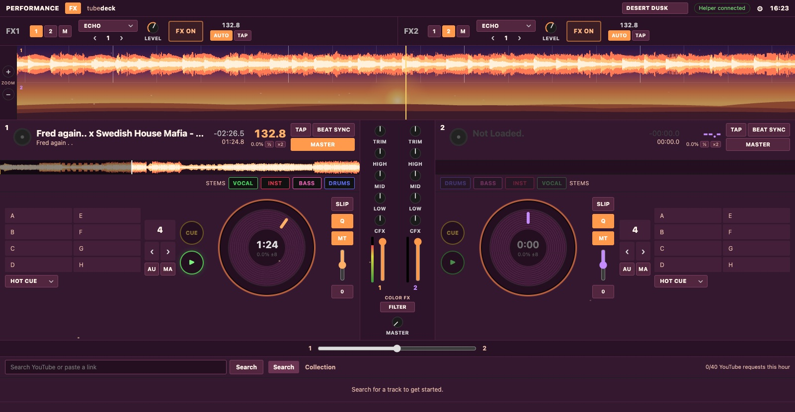

**Snowy Mountain**

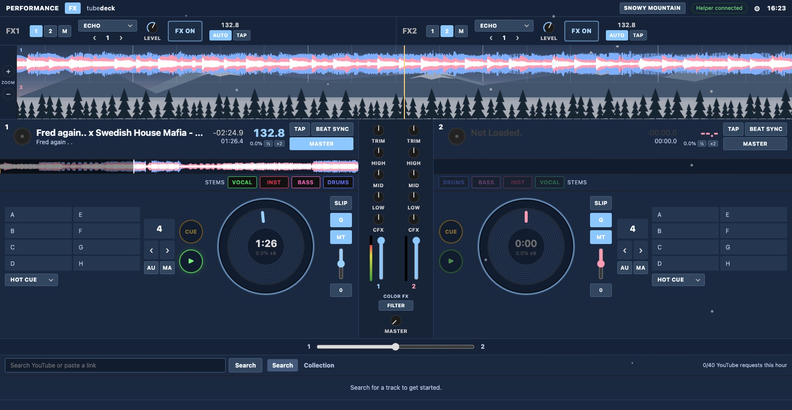

**ISS / Orbit**

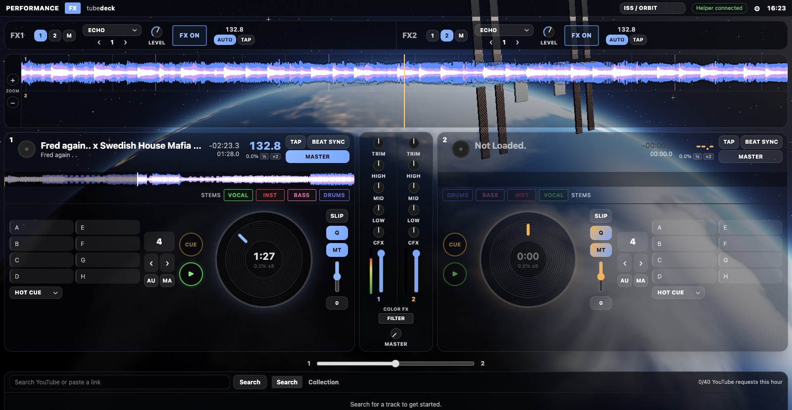

**Rainforest**

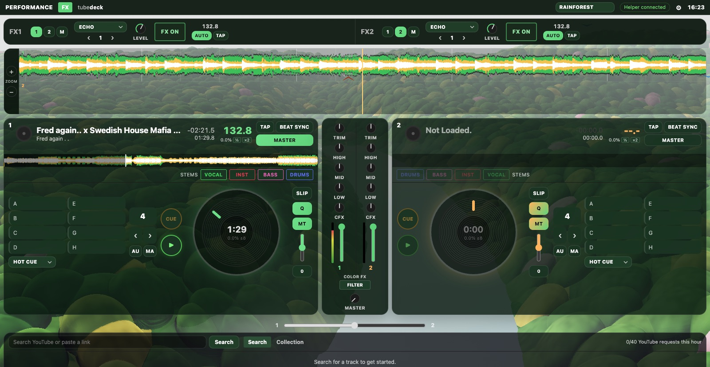

**Switzerland**

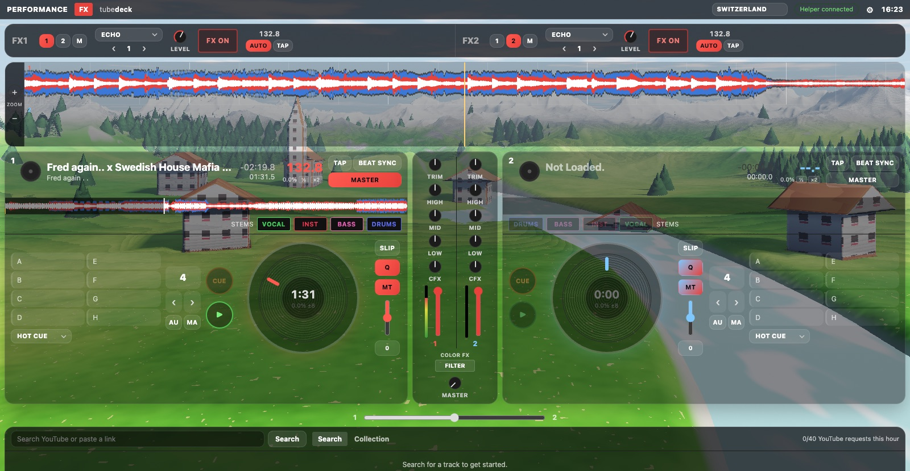

**Hakone**

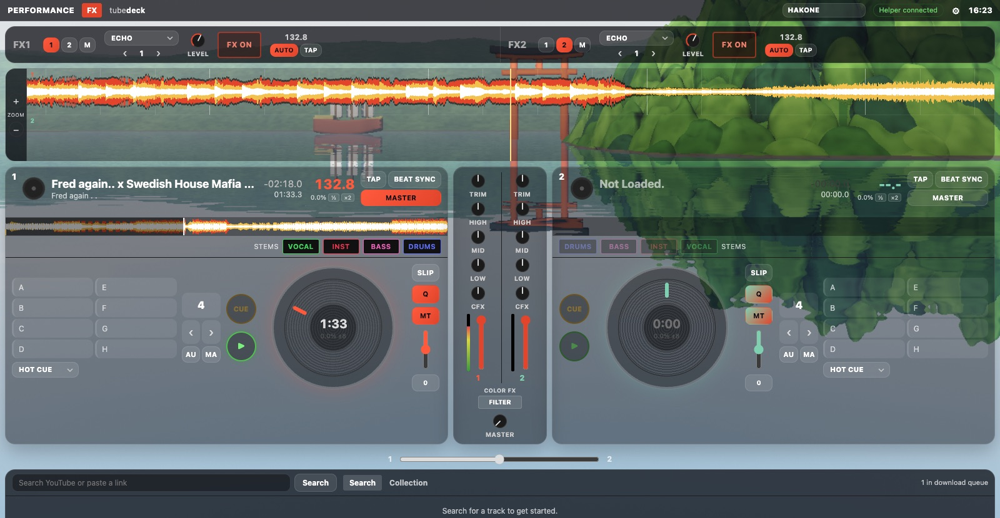

**Wulong Karst**

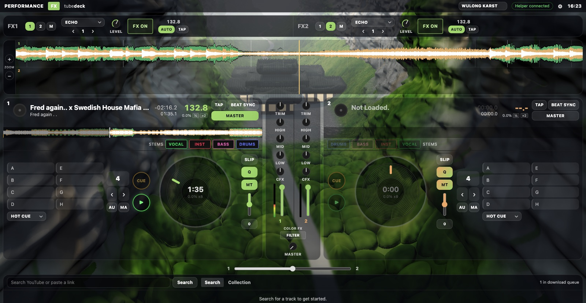

**Chongqing**

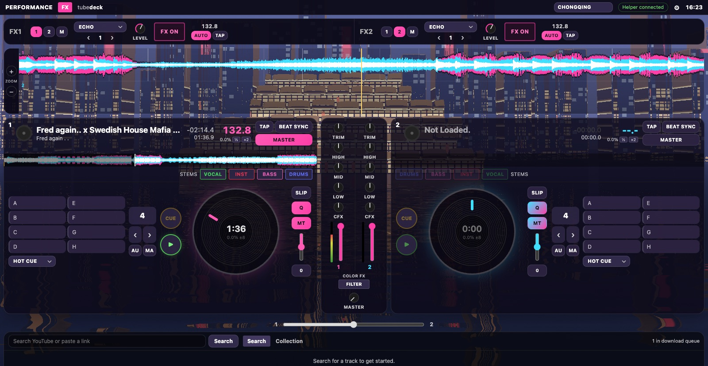

**Times Square**

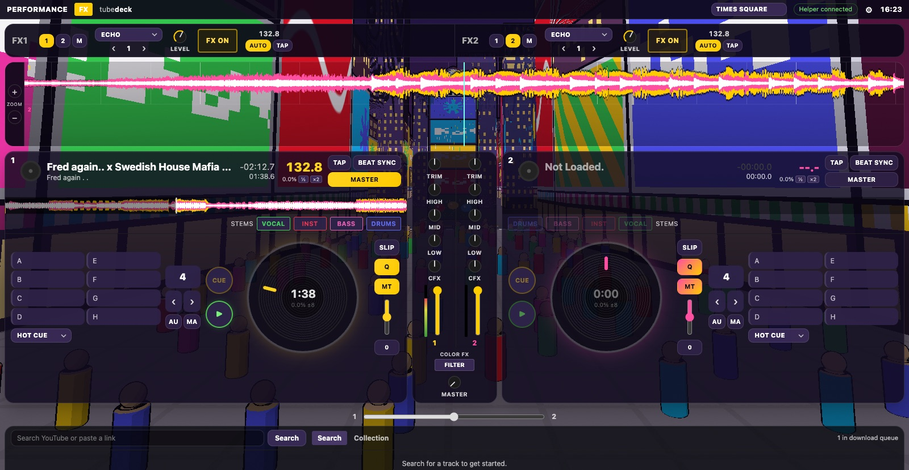

**Williamsburg**

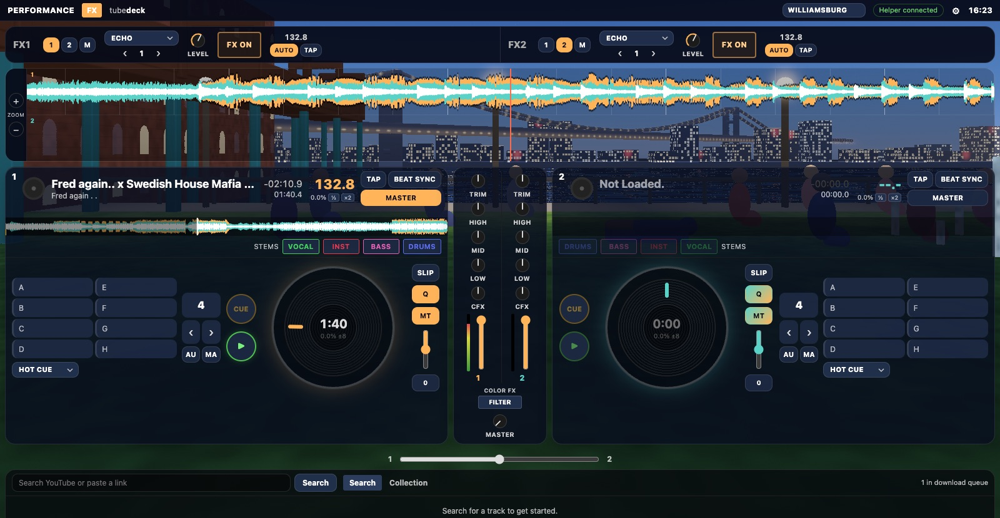

**Aurora**

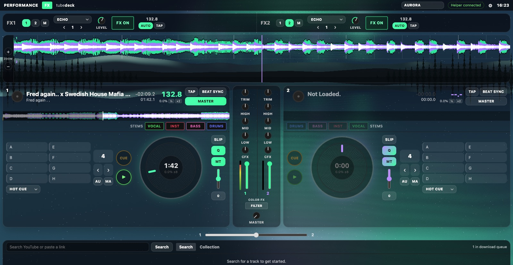

</details>

## Notes

YouTube's terms don't allow downloading. This is a personal practice tool; keep the throttle settings as they are and use it for your own practice.
